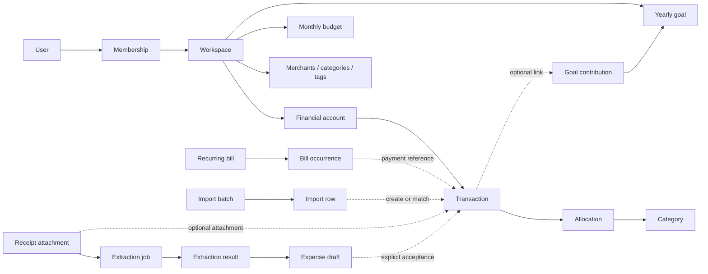

This is an implemented TypeScript model proposal, not a database schema or a
commitment to deliver every workflow. The original
[product scope](/docs/product-scope) is the reference; its sections explicitly
mark many entities and supporting behaviors as proposed. The
[glossary](/docs/glossary) defines the shared language.

## Confirmed direction

The subsequent conversation narrows the original draft:

- Couples and households first; mobile first with a web companion.
- Online editing with cached viewing, rather than durable offline financial writes.
- NestJS backend and Drizzle ORM; Expo and the shared Tamagui UI are established.
- Workspace roles: **owner, editor, viewer**. Owners and editors edit shared
  finances, viewers read, and owners manage membership.
- Accounts in different currencies are supported from the first release, retaining
  each account’s currency. Reporting currency is a workspace preference, not
  a replacement for original amounts.

These decisions override older architecture suggestions in the scope. Desktop
packaging, bank connectivity, OCR providers, and supported currency/market lists
are not decided here.

## Relationships



Every shared record carries a workspace identifier, identity, version, timestamps,
and creator/updater identity. Supporting records in the diagram also belong to
one workspace. Users are global identities, separate from financial accounts.
Private accounts within a household are not modeled yet.

A transaction is one aggregate. A transfer contains its debit and credit legs;
a categorized transaction contains its allocations. A budget contains its
category limits. Embedded parts must ultimately save together, not through
independent partial financial writes.

## Code and maturity

Modules in `packages/domain/src` import no NestJS, Drizzle, or UI libraries.

| Module            | Concepts                                                         | Status                                            |
| ----------------- | ---------------------------------------------------------------- | ------------------------------------------------- |
| `identity.ts`     | Typed identities, workspace scope, versions and metadata         | Shared foundation                                 |
| `money.ts`        | Exact decimals, arithmetic, rounding, attributed conversions     | Working pure functions                            |
| `calendar.ts`     | Dates, year/month values, monthly bill dates                     | Working functions; month-end clamping is proposed |
| `workspace.ts`    | Users, workspaces, membership and permission policy              | Confirmed roles; working predicate                |
| `catalog.ts`      | Financial accounts, merchants, categories, tags                  | Model proposal based on confirmed features        |
| `transactions.ts` | Expense, income, refund, transfer, allocations, provenance       | Model proposal with relationship validation       |
| `planning.ts`     | Monthly budgets, yearly goals, contributions, bills and payments | Proposed model; workflow policies remain open     |
| `intake.ts`       | Import decisions, receipts, extraction jobs/results and drafts   | Proposed workflows; types only                    |
| `rules.ts`        | Account, transaction, budget and goal invariants                 | Working validators for parsed records             |
| `spending.ts`     | Booked spending by original currency                             | Working helper; caller selects period and dataset |

## Financial rules

```ts
import { money, addMoney } from '@quilt/domain';

const total = addMoney(money('0.10', 'EUR'), money('0.20', 'EUR'));
// { amount: '0.3', currency: 'EUR' }
```

**Money and FX.** Monetary values serialize as exact decimal strings plus currency
codes. Arithmetic uses integer coefficients internally; amounts do not pass
through JavaScript floating point. Trailing zeros normalize away; display
formatting belongs in the UI. Currency validation checks syntax, not membership
in an approved currency list. Callers explicitly select precision (0–18
fractional digits) and rounding: half-even, half-away-from-zero, or toward-zero.

A conversion returns original and converted money, quote, provenance, precision,
and rounding. Rates mean quote-currency units per base-currency unit; they are
never implicitly inverted. Rate source and historical/current valuation policy
are undecided. Mixed-currency spending returns separate totals until a reporting
policy explicitly converts them.

**Accounts.** Each account has one currency and a signed opening balance anchored
to a calendar date. Cash, bank, and credit-card are provisional initial kinds.
A liability can have a negative opening balance and a credit balance can be
positive. The balance calculator treats the opening balance as an end-of-day
checkpoint and includes subsequent booked activity. The finance API locks the
checkpoint and currency once an account has transaction history.

**Transactions.** Expenses, income, and refunds carry positive magnitudes; their
kind defines their meaning. Allocations are positive, use the transaction
currency, and sum exactly to its amount. A null category represents uncategorized
activity. This is category splitting, not debt settlement between partners.
Expense/refund allocations use expense categories; income uses income categories.
Archived organization records remain valid historical references. Commands will
separately prevent choosing archived records for new activity.

Transfers reference distinct accounts in one workspace. Same-currency legs must
balance; fees are separate expenses. Cross-currency transfers retain both actual
amounts. An optional supporting quote does not prove the executed exchange rate.
Transfer legs and transaction allocations must commit atomically.

A linked refund requires an original, nonvoided expense in the same workspace and
currency. Unlinked refunds are allowed. Cumulative refund limits, cross-currency
refund matching, and attribution to closed budget months remain open. Spending
subtracts refunds in the caller-selected dataset and excludes transfers, income,
pending records and voided records. The helper rejects mixed-workspace data and
duplicate transaction IDs. It cannot establish complete totals from partial
cached history.

**Budgets and goals.** The proposed initial budget is a calendar-month envelope
with an overall limit and distinct expense-category limits. Limits share one
currency, are nonnegative, and category limits cannot exceed the overall limit;
unassigned room is allowed. Rollover, overlapping budgets, overspending rules,
and conversion of foreign-currency spending are not implemented.

A goal has a calendar year and positive target. Contribution/withdrawal records
are a proposed way to represent progress in the goal currency. A contribution
is planning information, not a second transaction. Funding sources, reversals,
transaction matching, progress calculation and cross-currency funding need
product decisions before a calculator or persistence is implemented.

**Bills.** Recurring bills are expectations; occurrences snapshot one dated
expectation. The amount may remain unknown for variable bills. Monthly dates
29–31 provisionally clamp to the last valid day of a shorter month, recalculated
for each month to prevent drift. A scheduled month remains the occurrence’s
stable identity if its due date changes. Payment links refer to portions of
existing transactions; they must not introduce another expense.

No occurrence generator, paid-status derivation, uniqueness constraint, matching
service or reminders exist yet. Payment allocation must later prevent allocating
more than a transaction’s available amount across occurrences. Partial payments,
overpayments, skipping, schedule edits, and foreign-currency payments remain open.

**Imports and receipts.** Source provenance and decisions are separate from
transaction organization. Matching should preserve existing user tags, notes,
merchant and category assignments. Retry deduplication differs from fuzzy
financial matching. Receipt extraction preserves original provider fields and
confidence separately from corrected draft values. Drafts may be incomplete;
explicit acceptance or matching is required to associate a transaction. An
invoice alone is not proof of payment.

The intake types hold private storage keys, not public document URLs. Storage,
parsers, matching, OCR, access authorization and workflow transitions are not
implemented. Their state types express intended outcomes, not a complete
validated state machine.

## Server and persistence responsibilities

Types and pure validators do not establish an authorization boundary. API
adapters must parse untrusted input, validate supported currency precision and
timestamp formats, and resolve references in the requested workspace. Never
trust client-supplied ownership, role, version or provenance.

Every command must check current membership. Maintain at least one active owner,
unique workspace membership, and explicit ownership-transfer/revocation rules.
Versions start at 1; atomically compare the expected version, apply a financial
aggregate change, increment its version, and write audit history. Idempotency
keys, request fingerprints and stored outcomes belong in the command/persistence
layer, not an offline client queue. Retrying a lost successful response must not
create another expense.

Only scalar constructors, permissions, the named core validators, and the
spending helper are implemented here. They do not validate every structural
field or graph of records. Bills, contributions, imports and extraction need
aggregate validators/state transitions once their policies are agreed.

The standalone Drizzle `workspaces` table is unchanged. The first
[finance API slice](/docs/development/finance-api) uses existing household
organization IDs as workspace boundaries and adds migrations for aggregate
records, audit history, operation results, and unique membership. Dedicated
contracts and adapters map domain records to persistence and HTTP payloads.

## Scenarios for the next slice

1. Alex edits a shared EUR account; Sam edits a shared USD account. A viewer sees
   both but cannot change either; revocation prevents future authorized reads.
2. An expense of `0.30` accepts allocations of `0.10` and `0.20`; allocations
   totaling `0.29` or mixing EUR and USD must fail.
3. An account-to-account transfer changes neither household spending nor income.
   A EUR-to-USD transfer retains actual debit and credit amounts, never a 1:1 guess.
4. A receipt-backed manual expense reappears in an import. Matching links the
   source/evidence to that expense instead of recording another expense.
5. A bill scheduled for day 31 falls on February’s last day, then March 31st.
   Linking its existing payment adds no new spending.
6. Two editors change version 4. The first accepted change produces version 5;
   the second receives a conflict instead of silently overwriting it.

## Remaining decisions

- Supported currencies/precision, FX sources/date selection, unavailable quotes,
  historical valuation, and report rounding.
- Budget rollover/overspending, overlapping plans, and refund attribution.
- Goal funding, contribution reversals and progress calculation.
- Bill partial/overpayments, variable amounts, skipped dates and schedule changes.
- Import formats, statement sign conventions, duplicates and pending/booked matching.
- Receipt review, extraction fields/provider and supported document formats.
- Invitations, ownership transfer, privacy/retention and cache cleanup.

The calendar-month envelope, positive transaction magnitudes, refund convention,
initial account kinds and month-end clamp are explicit provisional choices,
not newly confirmed requirements.
